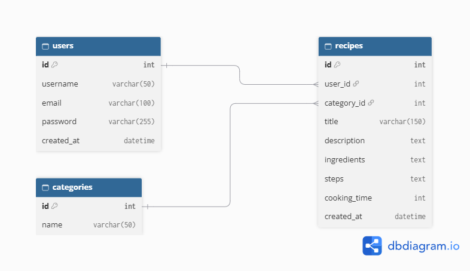

# Дәмді — рецепттер каталогы

PHP және MySQL қолданып жасалған веб-қосымша. Пайдаланушылар рецепттерді қосып, іздеп, санат бойынша сүзіп, басқалардың рецепттерін көре алады.

> Жеке жобалық тапсырма, PHP курсы. Жоба 8 аптаға созылады (8–15 апта).

## Жобаның мақсаты

Рецепттерді бір жерде жинап, оларды ыңғайлы іздеуге және басқаруға мүмкіндік беретін қарапайым каталог жасау.

## Технологиялар

- **Frontend:** HTML, CSS, JavaScript
- **Backend:** PHP 8 (PDO)
- **Дерекқор:** MySQL
- **Орта:** XAMPP (локальды), InfinityFree (хостинг)

## Негізгі мүмкіндіктер

- Тіркелу, кіру және шығу (парольдер `password_hash()` арқылы сақталады)
- Рецепт қосу, көрсету, өңдеу және жою (CRUD)
- Атауы бойынша іздеу және санат бойынша сүзу
- Сұрыптау және пагинация
- Деректерді тексеру (валидация) және қауіпсіздік (prepared statements, `htmlspecialchars()`)
- Қосымша функция: 14-аптада таңдалады

## Беттер тізімі

| № | Бет | Файл | Сипаттамасы |
|---|-----|------|-------------|
| 1 | Басты бет | `index.php` | Рецепттер тізімі, іздеу, санат бойынша сүзу, пагинация |
| 2 | Рецепт беті | `recipe.php` | Бір рецептті толық көрсету |
| 3 | Тіркелу | `register.php` | Жаңа пайдаланушыны тіркеу |
| 4 | Кіру | `login.php` | Жүйеге кіру |
| 5 | Рецепт қосу | `add.php` | Жаңа рецепт қосу (тек кірген пайдаланушыға) |
| 6 | Рецептті өңдеу | `edit.php` | Өз рецептін өзгерту |
| 7 | Менің рецепттерім | `my.php` | Өз рецепттерінің тізімі, жою |

## Дерекқор құрылымы (ER-диаграмма)

**Байланыстар:**
- Бір пайдаланушыда көп рецепт болады (`users` 1 : N `recipes`).
- Бір санатта көп рецепт болады (`categories` 1 : N `recipes`).

## Жоба жоспары

| Апта | Тақырып | Нәтиже |
|------|---------|--------|
| 8 | Жоспарлау және репозиторий | README, беттер тізімі, ER-диаграмма |
| 9 | Frontend | Кемінде 3 статикалық бет |
| 10 | PHP негіздері | PHP беттері, жұмыс істейтін форма |
| 11 | Дерекқор және аутентификация | Тіркелу, кіру, шығу |
| 12 | CRUD | Рецепттермен толық CRUD |
| 13 | Мәліметтермен жұмыс | Іздеу, сүзу, сұрыптау, пагинация |
| 14 | Қосымша функция және қауіпсіздік | Қосымша функция, қауіпсіздік тексерісі |
| 15 | Тестілеу, хостинг, қорғау | Хостингтегі жоба, есеп, қорғау |

## Автор

- Aselya23
